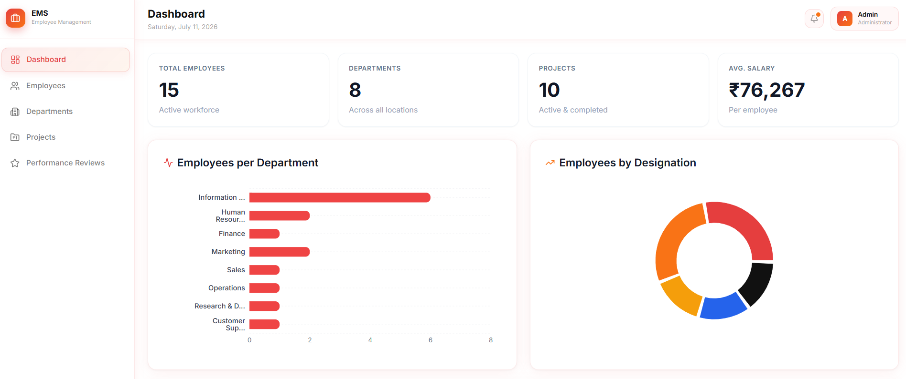
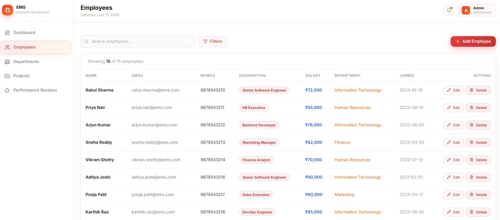
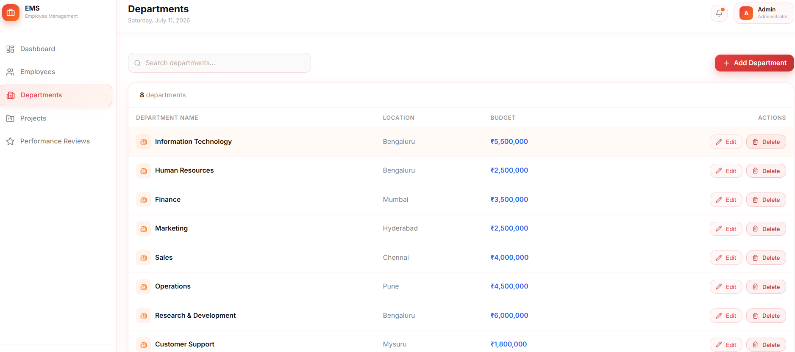
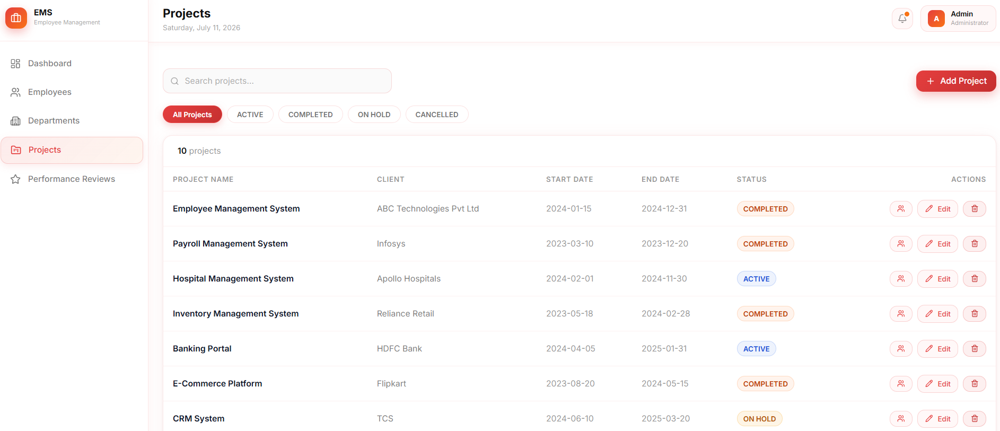
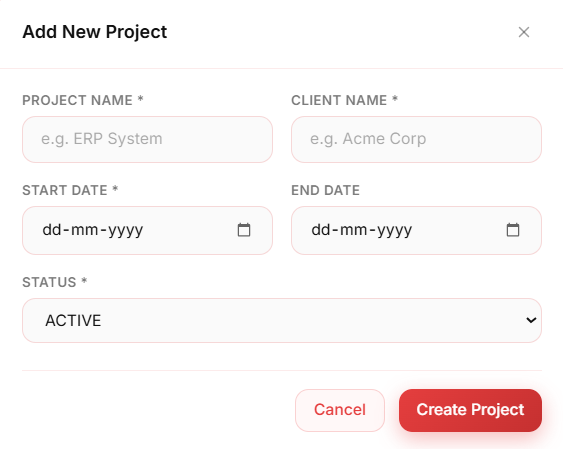
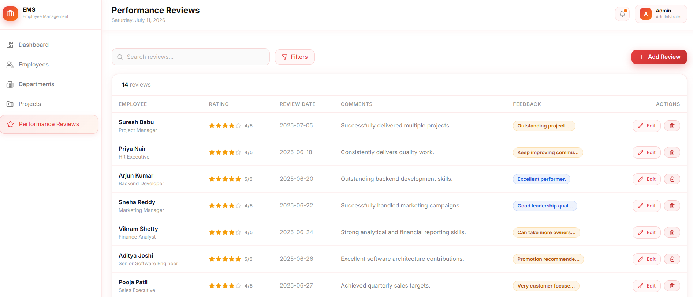
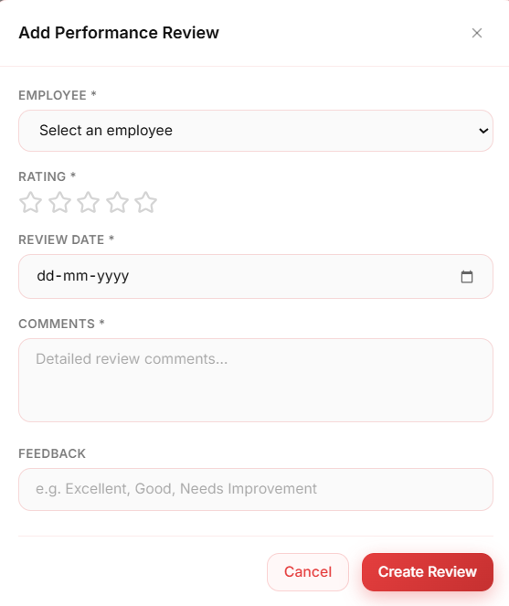

# Employee Management System

Enterprise-level Full Stack Employee Management System built using **Spring Boot**, **React.js**, and **MySQL**. This application provides a centralized platform to manage employees, departments, projects, and performance reviews through RESTful APIs with a modern, responsive user interface.

---

## Project Overview

Managing employee information, department records, project assignments, and performance reviews manually becomes increasingly difficult as an organization grows. This project was developed to provide a centralized, scalable, and maintainable solution for handling day-to-day employee management operations.

The application follows a layered architecture using Spring Boot for the backend and React.js for the frontend. It enables administrators to efficiently perform CRUD operations, assign employees to projects, maintain department information, and track employee performance.

---

## Key Features

### Employee Management

- Create new employees
- Update employee information
- Delete employees
- View employee details
- Search employees using REST APIs

### Department Management

- Create departments
- Update department information
- Delete departments
- Manage department budgets
- Assign employees to departments

### Project Management

- Create projects
- Update project details
- Assign employees to multiple projects
- Track project status

### Performance Review Management

- Record employee performance reviews
- Maintain ratings and feedback
- Track review history

### Dashboard

- Total Employees
- Total Departments
- Total Projects
- Average Salary
- Employees by Department Chart
- Employees by Designation Chart
- Recently Joined Employees

---

## Technology Stack

### Backend

- Java 21
- Spring Boot
- Spring Data JPA
- Hibernate ORM
- Maven

### Frontend

- React.js
- Vite
- Bootstrap 5
- Axios
- React Router DOM

### Database

- MySQL

### Development Tools

- Eclipse IDE
- Visual Studio Code
- Git
- GitHub
- Postman

---

## System Architecture

The application follows a layered architecture to ensure maintainability, scalability, and separation of concerns.

```
React.js Frontend
        │
        ▼
 REST APIs (Spring Boot)
        │
        ▼
 Service Layer
        │
        ▼
 Repository Layer (Spring Data JPA)
        │
        ▼
     MySQL Database
```

---

## Project Structure

```
Employee-Management-System
│
├── employee-management-system-backend
│   ├── src/main/java
│   ├── src/main/resources
│   ├── pom.xml
│   └── mvnw
│
├── employee-management-system-frontend
│   ├── src
│   ├── public
│   ├── package.json
│   └── vite.config.js
│
├── docs
│   └── images
│
└── README.md
```

---

## Project Modules

### Employee Module

- Create Employee
- Update Employee
- Delete Employee
- View Employee Details
- Search Employee

---

### Department Module

- Create Department
- Update Department
- Delete Department
- Department Budget Management

---

### Project Module

- Create Project
- Assign Employees
- Update Project
- Delete Project
- Track Project Status

---

### Performance Review Module

- Create Reviews
- Update Reviews
- Delete Reviews
- Employee Rating Management

---

## Application Screenshots

### Dashboard



---

### Employee Management



---

### Add Employee


---

### Department Management



---

### Add Department


---

### Project Management



---

### Add Project



---

### Performance Review Management



---

### Add Performance Review



## Installation Guide

### Prerequisites

Before running the project, ensure you have the following installed:

- Java 21
- Node.js (LTS Version)
- MySQL Server
- Maven
- Git

---

### Clone the Repository

```bash
git clone https://github.com/niranjanhr27/Employee-Management-System.git
```

---

### Backend Setup

Navigate to the backend project.

```bash
cd employee-management-system-backend
```

Configure your MySQL database in:

```
src/main/resources/application.properties
```

Run the Spring Boot application.

```bash
mvn spring-boot:run
```

The backend will start on:

```
http://localhost:8080
```

---

### Frontend Setup

Navigate to the frontend project.

```bash
cd employee-management-system-frontend
```

Install dependencies.

```bash
npm install
```

Start the development server.

```bash
npm run dev
```

The frontend will be available at:

```
http://localhost:5173
```

---

## REST API Overview

The backend exposes RESTful APIs for managing employees, departments, projects, and performance reviews.

### Employee APIs

- Create Employee
- Get All Employees
- Get Employee By ID
- Update Employee
- Delete Employee
- Get Employee By Name
- Get Employee By Designation
- Get Employee By Name And Salary
- Get Employees By Salary Greater Than
- Get Employees By Salary Between
- Find Employees By Department Name
- Get Projects By Employee ID

---

### Department APIs

- Create Department
- Get All Departments
- Get Department By ID
- Update Department
- Delete Department

---

### Project APIs

- Create Project
- Get All Projects
- Get Project By ID
- Update Project
- Delete Project
- Find Projects By Status
- Get Employees Of Project
- Get Projects By Employee ID
- Assign Employee To Project

---

### Performance Review APIs

- Create Review
- Get All Reviews
- Get Review By ID
- Update Review
- Delete Review
- Find Reviews By Rating Greater Than
- Find Reviews By Review Date Between

## Highlights

- Layered Architecture
- DTO Pattern
- Entity Relationships
- Spring Data JPA
- Hibernate ORM
- Exception Handling
- Validation
- RESTful API Design
- Responsive User Interface
- Dashboard with Charts
- Modular Code Structure

---

## Developer

**Niranjan H R**

Aspiring Java Full Stack Developer

GitHub:
https://github.com/niranjanhr27

---

## Acknowledgement

This project was developed as part of a Java Full Stack learning journey to strengthen practical knowledge of Spring Boot, React.js, MySQL, REST APIs, and enterprise application development. It demonstrates full-stack development concepts including CRUD operations, layered architecture, responsive UI design, and database integration.
